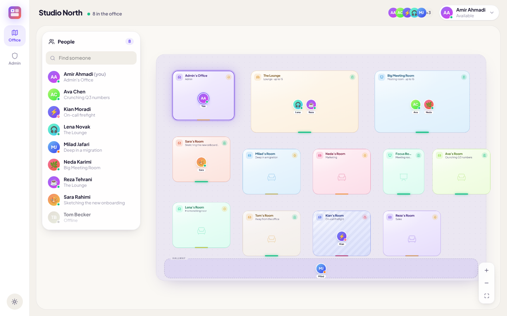
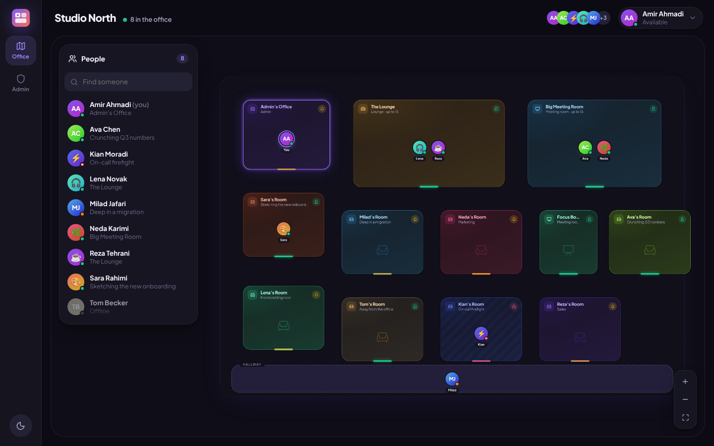
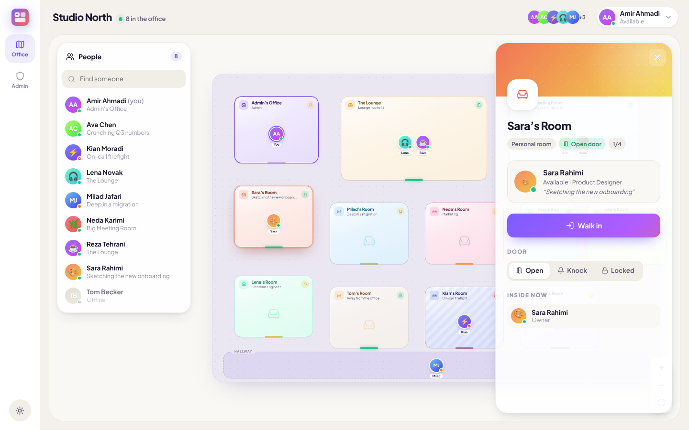
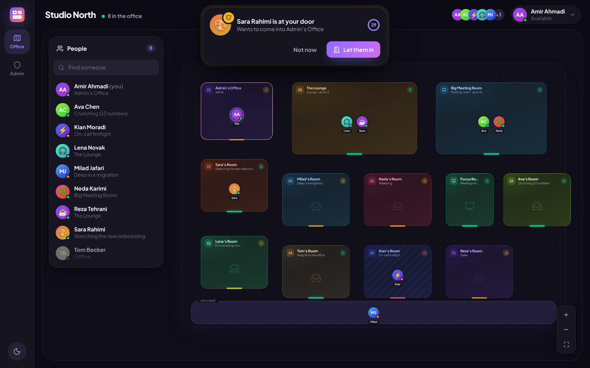
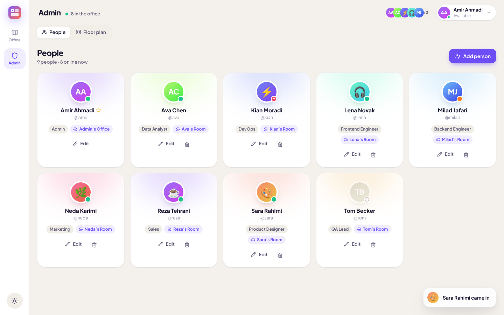
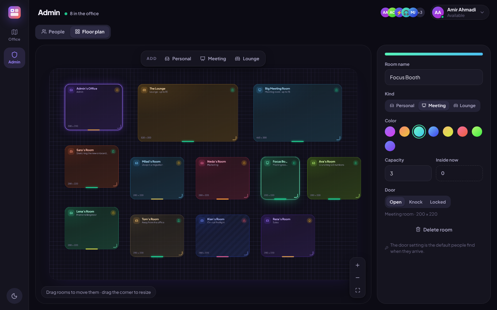
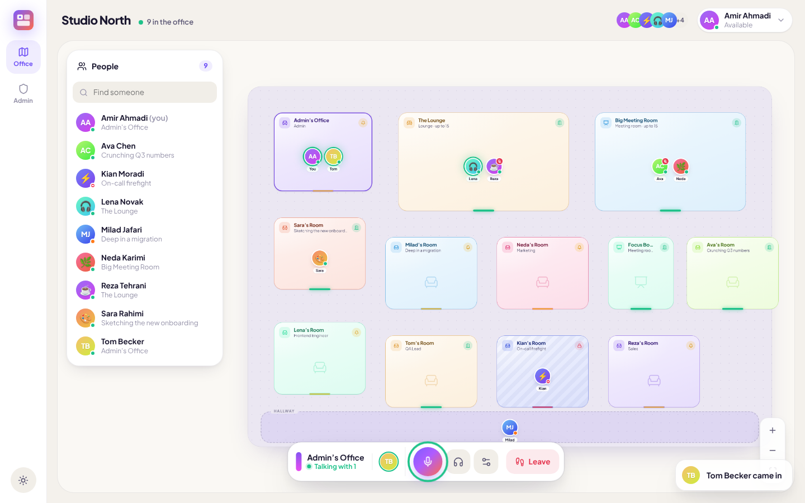
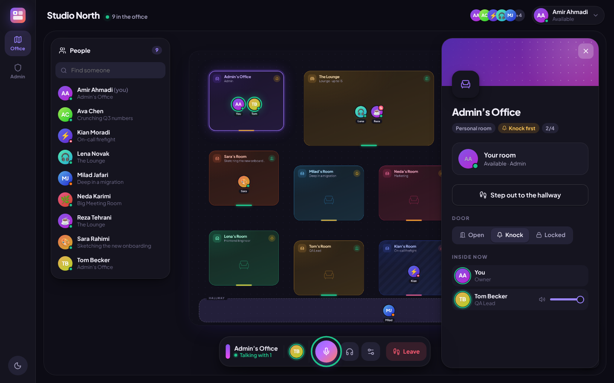
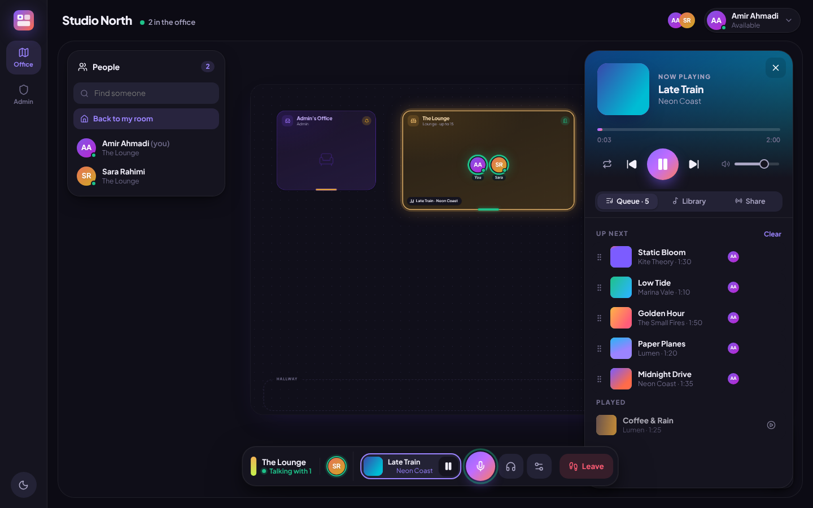
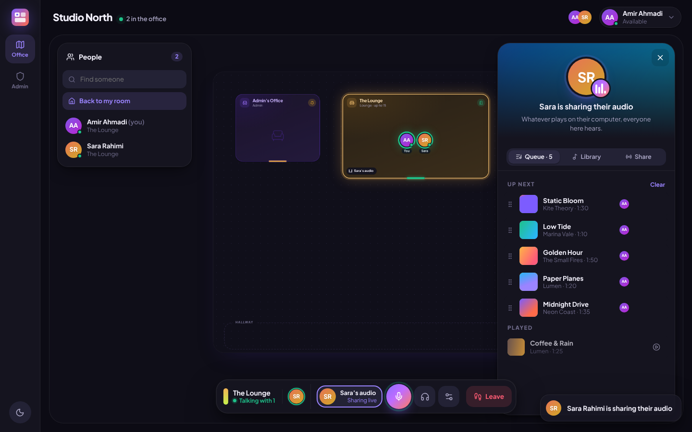

# Office

A virtual office for your team's local network. Everyone has a room on an interactive floor plan, so you can see who's around, ring a coworker's doorbell, and walk in to talk. It runs entirely on your office Wi-Fi: one computer is the server, and everyone else uses the desktop app.

> **Status: Phase 3 of 6.** Done so far: the office map, presence, statuses, doorbells, room locks, profiles, the admin area, voice, and music. Coming next: messaging, meeting rooms with screen sharing, and installers. See the [roadmap](#roadmap).

| Light | Dark |
| --- | --- |
|  |  |
|  |  |
|  |  |
|  |  |
|  |  |

## What it does today

- **Live office map.** A floor plan with personal rooms, meeting rooms and lounges. Avatars walk between rooms in real time, and people outside any room stand in the hallway.
- **Doors and doorbells.** Each room is *Open* (walk in), *Knock* (ring the bell, someone inside lets you in) or *Locked*. A doorbell plays a chime and shows a 30-second card with **Let them in** / **Not now**.
- **Voice.** Walk into a room and you're talking with everyone there. A dock at the bottom shows who's in the call, with mute, sound off and leave buttons. Speaking avatars glow on the map, and muted people show a crossed-out mic.
  - Each person in your room has a volume slider. Volumes are remembered on your computer.
  - Audio settings let you pick the microphone and speakers, check your level on a live meter, and switch noise suppression and echo cancellation.
  - Shortcuts: **Ctrl+Shift+M** mutes, **Ctrl+Shift+D** turns sound off (Cmd on a Mac). If you talk while muted, the app reminds you.
  - Your mic only switches on while someone else is in your room, so the system's "mic in use" light goes off when you're alone.
- **Music.** Every room has its own player, and everyone inside hears the same song at the same moment.
  - **Library:** one for the whole office. Drop MP3, M4A, FLAC, OGG, Opus, WAV or WebM files onto the music panel (up to 60 MB each). Titles, artists and album art are read from the files.
  - **Queue:** play now, play next, add to queue, drag to reorder, repeat the queue or one song. Anyone in the room can control it.
  - **Share your computer's audio:** whatever plays on your computer (Spotify, YouTube…) is heard by everyone in the room. The queue waits while you share.
  - **Volume:** music has its own volume and fades down while people talk (you can turn that off). The map shows what's playing in every room.
  - **Empty rooms:** the music pauses when everyone leaves and picks up there when someone comes back.
- **Statuses.** Available, Busy, Away or Do not disturb, plus a custom status line. Do not disturb locks your door and silences your doorbell.
- **Profiles.** Name, title, color, emoji or uploaded photo, and password.
- **Admin area.** Add and remove people (with generated passwords and an automatic personal room), and edit the floor plan by dragging, resizing, recoloring and assigning rooms.
- **Light and dark themes**, following the system or chosen by hand, with smooth animations throughout (they respect the OS "reduce motion" setting).

## Running it

You need [Node.js 22](https://nodejs.org) or newer on the server computer.

```bash
npm install
npm run build
npm start
```

The server prints its address, for example:

```
  Office server is running.

  On this computer:  http://localhost:4000
  On the office Wi-Fi: http://192.168.1.20:4000
```

Open that address. The first visit asks you to set up the office and create the admin account. Then go to **Admin → People** to add your coworkers.

| Setting | Default | Meaning |
| --- | --- | --- |
| `PORT` | `4000` | Port to listen on |
| `HOST` | `0.0.0.0` | Interface to listen on (all, so the LAN can reach it) |
| `DATA_DIR` | `server/data` | Where the database, avatars, music and signing key live. Back this folder up. |

If coworkers can't connect, allow port 4000 through the server computer's firewall (on Windows, accept the prompt the first time Node starts).

### The desktop app

Download the installer from the [latest release](https://github.com/amir-r-z-a/office-app/releases/latest):

- **Windows:** `Office-Setup-x.y.z.exe`. The app isn't code-signed, so Windows shows "Windows protected your PC": click **More info → Run anyway**. It installs for your user without asking for admin rights.
- **macOS:** `Office-x.y.z.dmg` (one file for Apple Silicon and Intel). Drag Office into Applications. The first time you open it, macOS blocks it because it isn't from an identified developer: go to **System Settings → Privacy & Security** and click **Open Anyway**.

**Updates:** the app checks for new releases at startup and every 4 hours, downloads them in the background, and shows a glowing button in the sidebar to restart into the new version. You never reinstall. The office screens themselves come from your office server, so most new features arrive just by updating the server. The desktop app only needs an update when its own shell changes.

To run the desktop app from source instead:

```bash
cd desktop
npm start          # downloads Electron the first time
```

On a Mac, `npm start` opens Electron as its own app, not as part of your terminal. That way macOS asks permission for Electron, which system-audio sharing needs. The first time you share audio, allow **Screen & System Audio Recording**, then quit (tray icon → Quit) and reopen.

On first launch it asks for the server address (for example `192.168.1.20:4000`) and remembers it. Closing the window keeps the app in the system tray, so doorbells still ring. The tray menu can start it when you sign in to your computer. Windows and macOS installers come in Phase 6.

### Developing

```bash
npm run dev        # server on :4000 with reload, web app on :5173 with hot reload
npm test           # server tests
npm run typecheck
```

## Releasing a new desktop version

1. Set `"version"` in `desktop/package.json`, say `0.2.0`.
2. Commit and push to `main`.
3. GitHub Actions sees a version with no release yet, builds both installers on real Windows and Mac machines, and publishes release `v0.2.0`. That usually takes about 10 minutes. Installed apps pick it up on their next check.

For apps to download updates, the repository's releases must be public.

## How it's built

```
shared/   Types and the realtime protocol used by both sides
server/   Fastify + WebSockets + SQLite (Node's built-in node:sqlite)
web/      React + Vite + Framer Motion + Zustand: the whole UI
desktop/  Electron shell that loads the UI from the office server
```

- The server keeps users, rooms and the floor in SQLite, and keeps live state in memory: who's online, where everyone is, and doorbells in flight. Every change is pushed to every app over one WebSocket.
- The desktop app loads the UI from the server, so updating the server updates everyone.
- Voice is peer to peer over WebRTC. Everyone in a room has a direct audio link to each other person there, negotiated through the server, which only relays between people in the same room. On a LAN no STUN or TURN server is needed, and audio never passes through the server.
- Music sync: the server owns each room's queue and the position of the current song, and moves to the next song when one ends. Each app estimates the server clock from a few round trips, then keeps its player within about a tenth of a second by nudging the speed, or jumping if it's far off. Song files are served with range requests, so seeking doesn't download the whole file.
- Sharing audio uses a second channel on the voice connections that stays silent until someone shares, so starting a share needs no renegotiation.
- Browsers only allow the microphone on secure pages. The desktop app allows it for your office server. In a plain browser, voice works at `http://localhost` (on the server computer itself) or behind HTTPS.
- Passwords are hashed with scrypt, and sessions are signed tokens.
- No internet access is needed at runtime. Fonts and sounds are bundled or synthesized.

## Roadmap

1. ✅ **Core:** sign-in, admin, floor plan editor, live map, presence, statuses, doorbells, locks
2. ✅ **Voice:** talk with everyone in your room, mute, sound off, per-person volume, device settings
3. ✅ **Music:** shared library, synced queue per room, sharing your computer's audio
4. **Messaging:** direct messages, room chat, an office channel, unread badges and notifications
5. **Meeting rooms and screen sharing**
6. **Packaging:** Windows/macOS installers and a one-step server setup
